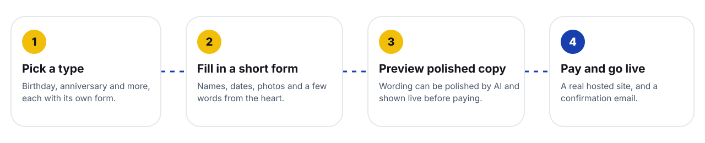

<div align="center">


<br>


**A website builder for personal occasions.** A client picks a type, fills in a short form, previews polished copy, pays, and gets a real hosted website.

[Quick start](#quick-start) | [How it works](#how-it-works) | [Docs](#documentation) | [Versions](docs/VERSIONS.md)

</div>


## How it works



Behind that short journey sits a full admin dashboard where you shape every part of it.

## What you get

<table>
<tr>
<td width="50%" valign="top">

**For clients**
- A gallery of website types with their own forms
- Live, interactive preview before paying
- Prices in the visitor's own currency
- Hosted site plus a confirmation email
- Optional site password and photo uploads
- Leave a review through a private link

</td>
<td width="50%" valign="top">

**For you**
- Website types, fields and versioned templates
- Landing page, SEO pages, FAQ and legal pages as editable content
- Deployments, analytics, activity feed and recovery tools
- Client review moderation and a public reviews page
- Promotions you can embed on other sites
- Sale alerts, multiple email providers, optional AI copy

</td>
</tr>
</table>

## Quick start

```bash
git clone <repo-url> heartcode
cd heartcode
npm install              # also builds the CSS
cp .env.example .env     # fill in the required values
npm start
```

Then open `http://localhost:3000/health` and sign in at `/<ADMIN_PATH_SLUG>/login`.

Deploying instead? Render works from a phone with no terminal. Follow [docs/SETUP.md](docs/SETUP.md).

## Documentation

| Read this | For |
|---|---|
| [docs/SETUP.md](docs/SETUP.md) | Deploy on Render, run locally, first checks |
| [docs/ENVIRONMENT.md](docs/ENVIRONMENT.md) | Every environment variable and what happens without it |
| [docs/CONFIGURATION.md](docs/CONFIGURATION.md) | Hosting, email, payments, geolocation and AI on the admin pages |
| [docs/PROMOTIONS.md](docs/PROMOTIONS.md) | Campaigns, the embeddable script, iframe, tracking |
| [docs/ARCHITECTURE.md](docs/ARCHITECTURE.md) | Stack, layout and the ideas behind the code |
| [docs/VERSIONS.md](docs/VERSIONS.md) | What changed in every release |
| [DEPLOYMENT.md](DEPLOYMENT.md) | The long Render walkthrough with troubleshooting |
| [docs/archive](docs/archive/README-full-original.md) | The complete original notes, kept for reference |

## Project layout

A lean repository:

```
db/          schema and migrations
lib/         helpers
middleware/  auth, CSRF, admin path gating
routes/      admin API, public pages, webhooks
views/       EJS templates
public/      static assets and scripts
src/         Tailwind sources
docs/        documentation
```

## Latest release

**v1.2.14** makes promotions reliable (no rate limits on delivery, one-request script, edge caching) and card only. **v1.2.15** makes client reviews text only. **v1.2.13** added the Promotion page and embeddable script. See [docs/VERSIONS.md](docs/VERSIONS.md) and [docs/PROMOTIONS.md](docs/PROMOTIONS.md).


<div align="center">

Made with care, one small website at a time.

</div>
